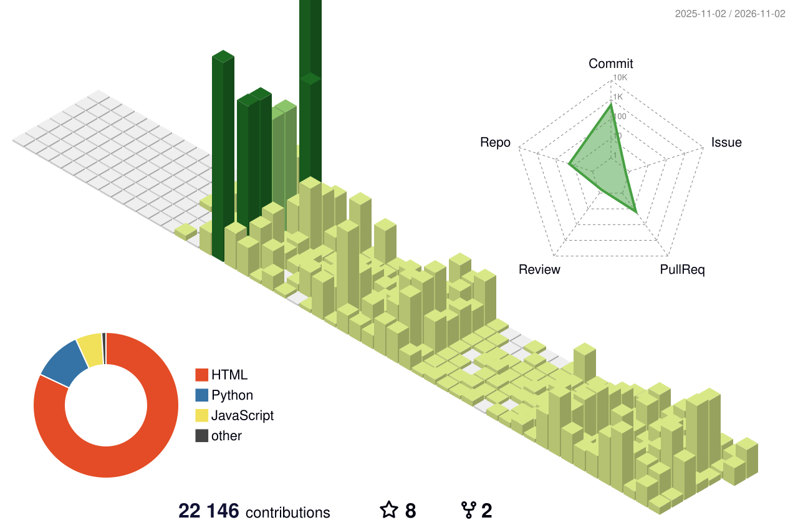

 

## 👋 About me

I'm **Bheda Nikhilkumar**, a second-year **B.Tech Computer Engineering** student at **Atmiya University, Rajkot** (2025 – 2029).

- 🛠️ I build full-stack web apps, developer tools and small AI/ML projects, end to end.
- 🛡️ I'm especially interested in **cybersecurity** and privacy-first software.
- 🌱 My loop: **Learn → Build → Break → Debug → Improve → Share.**

## 🧰 Tech I work with

  

## 🚀 Featured projects

### 🛡️ [Privex](https://github.com/bhedanikhilkumar-code/Privex)

A privacy-first threat-protection platform that detects phishing, scams and malicious links **on the device**, in real time, with no cloud dependency.
[**Try the web scanner →**](https://bhedanikhilkumar-code.github.io/Privex/)

`TypeScript` · `JavaScript` · `PWA` · `Vitest` · `Cloudflare`

### 🔎 [aevoraSEO](https://github.com/bhedanikhilkumar-code/aevoraSEO)

A command-line SEO, AEO and GEO (generative-engine optimization) audit engine, with a local web crawler, entity reputation scoring and backlink audits.
[**Latest release →**](https://github.com/bhedanikhilkumar-code/aevoraSEO/releases/tag/v1.1.0)

`Python` · `CLI` · `Web crawling` · `MIT licensed`

### 🩺 [Noninvasive Disease Risk Predictor](https://github.com/bhedanikhilkumar-code/noninvasive-disease-risk-predictor)

A web app that estimates early disease risk (such as diabetes or heart risk) from symptoms, lifestyle and basic vitals, then shows a risk score, insights and an analytics dashboard.

`React` · `Vite` · `Express` · `MongoDB` · `FastAPI` · `scikit-learn` · `Docker`

### 🎮 [Sneak Commit](projects/sneak-commit/index.html)

A tiny browser game that lives in this repo, built with plain HTML, CSS and JavaScript.
[**Play it in your browser →**](https://raw.githack.com/bhedanikhilkumar-code/bhedanikhilkumar-code/main/projects/sneak-commit/index.html)

<a href="https://github.com/bhedanikhilkumar-code?tab=repositories">See all repositories →</a>

## 📊 GitHub activity

<picture>
  <source media="(prefers-color-scheme: dark)" srcset="profile-3d-contrib/profile-night-green.svg" />
  <source media="(prefers-color-scheme: light)" srcset="profile-3d-contrib/profile-green-animate.svg" />
  
</picture>

## 🤝 Let's connect

I'm always happy to talk about projects, learning and building things together.

**[Portfolio](https://bheda.sites.tab.bot/)** · **[LinkedIn](https://www.linkedin.com/in/bheda-nikhilkumar-6858322ab/)** · **[GitHub](https://github.com/bhedanikhilkumar-code)**

Keep learning, keep building, keep improving. 🚀

